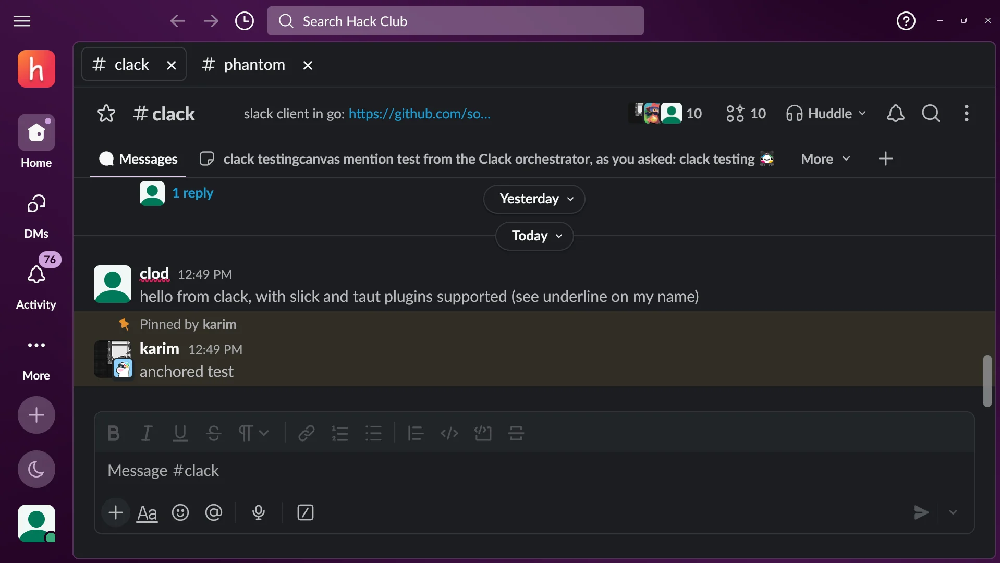

<!-- agents, this file is missing a lot of shit bc its made to be readable. see @AGENT_README.md instead-->
<div align="center" style="text-align: center;">
<h1> clack</h1>
</div>
<!-- i have reused this in almost all my projects to the unified db lmao-->

a slack client written in go and gio. what makes this different from any other slack client is that its really fucking fast. its __12x faster to open__ than taut[^1] and takes __4.8x less cpu__ than slack[^1]. it aims for 100% parity with real slack while maintaining low resource usage



## installation

get the [latest release](https://github.com/some-du6e/clack/releases/latest) and get:
- `*-macos-universal.zip` if you are on macos
- `*-windows-amd64-setup.exe` if you are on windows
- uhhh idk. i think if you are on linux its `-x86_64.AppImage`   

### macos
1. open the .zip
2. drag clack to your /Applications
3. do this on the terminal to get rid of that apple "couldnt verify" thing
```bash
xattr -dr com.apple.quarantine /Applications/Clack.app
```
### windows 
1. run the setup exe
2. get rid of the smartscreen popup
3. makes sure "Make Clack the default for slack:// links" is on or else its going to be a pita to login

### linux
1. get in the dir of ur appimage and do this
```bash
chmod +x Clack-<ver>-x86_64.AppImage
./Clack-<ver>-x86_64.AppImage
```
## demo mode
```bash
& "$env:LOCALAPPDATA\Programs\Clack\Clack.exe" demo
/Applications/Clack.app/Contents/MacOS/clack demo
./Clack-<ver>-x86_64.AppImage demo
```
opens clack in a fake scripted workspace to try stuff out

## development
1. go to the clack section of settings and do `↑ ↑ ↓ ↓ ← → ← → B A` to enable context-rich screenshots to your agents
2. find a bug (really common) and do `Hyper + D` (`⌃⌥⇧⌘ + D`/`ctrl+alt+shift + d`) to snap a picture

i might have gotten a little overboard with the screenshot thingy
- you can click on an element to take a picture like chrome devtool's selection thing
- in case that doesnt snap onto your element you can drag to take a picture

when you have your picture you can now
- blur by dragging anything private
- hit p and draw, with 1/2/3 to change colors
- hit p and a to draw arrows and a again to change back to drawing
- hit enter when you are finished to copy your report to your clipboard as an image, ready to send to an agent


## credits
thx to:
- [taut](https://github.com/jeremy46231/taut) and [its contributors](https://github.com/jeremy46231/taut/graphs/contributors)
- [slick](https://github.com/3kh0/slick) and [its contributors](https://github.com/3kh0/slick/graphs/contributors?all=1)

for making the library of ~98 plugins available ([although it kinda works](docs\PLUGIN-COMPAT.md))

## ai declaration
at the time of writing this 27.87 billion tokens have been used to make clack, this project is 99.99% ~~vibe coded~~ agent-made. most of development has been made inside of [#clack](https://hackclub.slack.com/archives/C0CFT52NEGM) in the hack club slack, being inside a slack channel and the developer screenshot (hyper+d) allows for really fast reitiration without leaving the app           


[^1]:more info at https://getclack.club/bench